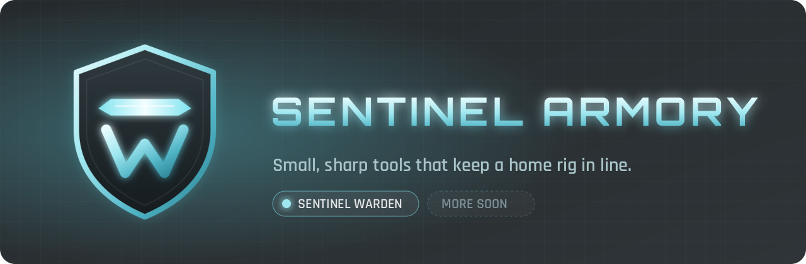
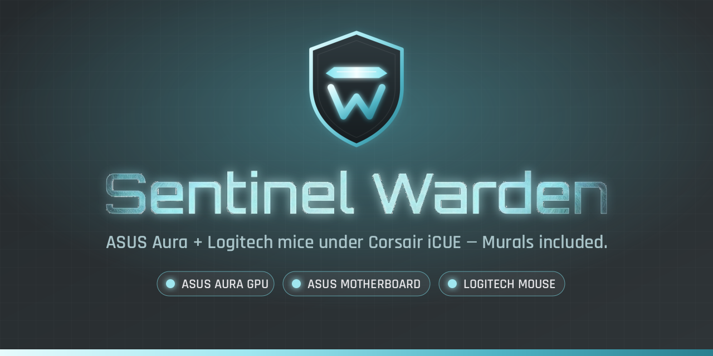
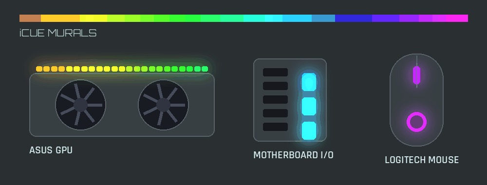

  

**Sentinel Armory** collects the tools that grow out of keeping one home rig in line: fixes that vendors
haven't shipped yet, bridges between apps that don't talk to each other, and the small utilities around them.
Everything is written down, open source and tested on real hardware before it gets a release.

## Projects

<table>
  <tr>
    <td width="50%" valign="top">
      
    </td>
    <td width="50%" valign="top">
      <h3><a href="https://github.com/sentinelarmory/sentinel-warden">Sentinel Warden</a></h3>
      
Every light on your desk, under one command: <b>Corsair iCUE</b>.

      <ul>
        <li>Gives iCUE control of <b>ASUS Aura</b> GPU and motherboard RGB again (Aura SDK 3.08 priority fix).</li>
        <li>Adds your <b>Logitech mouse</b> to iCUE as its own device, Murals included (tested: G403 HERO).</li>
      </ul>
      
<code>PowerShell</code> · <code>C</code> · <code>Windows 11</code> · MIT

    </td>
  </tr>
</table>

  

More tools land here as they are finished.
